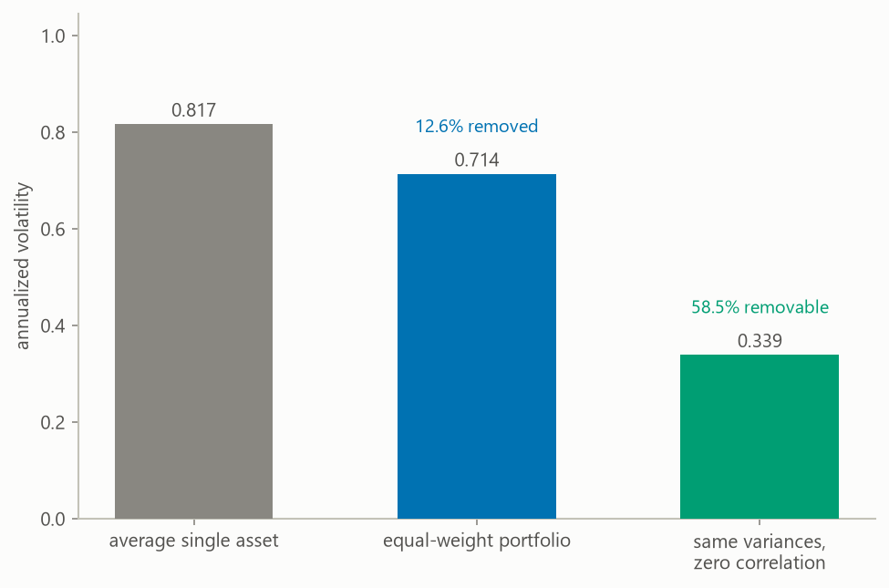

# crypto-sql-warehouse

This is a PostgreSQL warehouse for crypto market data. It pulls candles from
the public Coinbase Exchange API. A candle is the open, high, low, close, and
volume for one interval of time. That interval is the candle's timeframe, and
the warehouse can keep four timeframes per asset, which are 1 minute, 5
minutes, 15 minutes, and 1 hour. It stores the candles in three schemas named
raw, core, and marts, laid out under Architecture. The marts are the tables
built for analysis. They hold each asset's daily rollup of the candles,
returns, rolling volatility, drawdown from its earlier peak, and pairwise
correlations. They are built and tested with dbt, an open-source tool that
runs SQL files against a database in dependency order, described under
Architecture. Annotated analytical queries run against the warehouse in
`sql/04_queries.sql`. `scripts/run_export.py` writes stored candles or the
daily metrics to a CSV file.

I built it to learn how a warehouse is designed and kept correct, using market
data I already knew from my own trading research. I later extended it to more
timeframes, loaded history back to 2020, and moved the marts and the checks
into dbt. The CSV export is for quick
calculations on stored data, without a fresh download from the exchange.

I used the warehouse to measure how much volatility an equal-weight holding
of its six assets (Bitcoin, Ethereum, Solana, Cardano, Chainlink, and
Dogecoin) actually removes. Over 1,933 complete trading days from 2021-06-19
to 2026-10-09, spreading capital equally across all six removes only 12.6
percent of the volatility of holding the average one. If the six were
uncorrelated it would remove 58.5 percent. Every pair of the six correlates
between 0.63 and 0.84, averaging 0.72. Over this window, holding six of these
was close to holding one. [What the data shows](#what-the-data-shows) gives
the method and what the result does and does not justify. Loading newer days
and rerunning the analysis moves these figures. A test then fails until the
README matches the new `results/metrics.json`.

The chart below shows that result. Its three bars are the annualized
volatility of the average single asset, of the equal-weight portfolio, and of
that portfolio if the six assets were uncorrelated.



## Quick start

Requires git, Python 3.11 or 3.12, and a PostgreSQL server you can connect
to, such as one from the postgresql.org installer or a Docker container.
`run_setup.py` creates the database if it is missing, so the user you connect
as needs permission to create one, or you create the database first. Verified
on PostgreSQL 17.10 and Python 3.11. Nothing in the SQL needs a feature newer
than PostgreSQL 10. dbt installs with the other dependencies in step 4 and
needs no setup of its own, because the scripts hand it the connection from
`.env`.

In a terminal, run the following.

1. Clone the repository:

   ```
   git clone https://github.com/RAStevenson/crypto-sql-warehouse.git
   ```

2. Navigate to the root directory:

   ```
   cd crypto-sql-warehouse
   ```

3. Create a new environment and activate it (on Mac or Linux the second line
   is `source .venv/bin/activate`):

   ```
   python -m venv .venv
   .venv\Scripts\activate
   ```

4. Install dependencies:

   ```
   pip install -r requirements.txt
   ```

5. Copy the example config (on Mac or Linux the command is
   `cp .env.example .env`), then edit `DATABASE_URL` in `.env` to point at your
   server:

   ```
   copy .env.example .env
   ```

6. Create the database and its three schemas, have dbt build the marts, load
   a year of history, and refresh the marts:

   ```
   python scripts/run_setup.py
   python scripts/run_ingest.py
   ```

7. Compute the diversification result and its chart from the loaded data:

   ```
   python scripts/run_diversification_analysis.py
   ```

The first run of `run_ingest.py` fetches every active product at every active
timeframe. A product is a Coinbase trading pair such as BTC-USD. The six
seeded products start out active. Of the timeframes, only 1 hour starts out
active. A year is 8,760 hours per product and the API caps a request at 300
candles, so the default backfill is about 30 requests per product. For all
six, the first run took about 70 seconds on my machine on 2026-10-09,
including the mart refresh. Later runs resume from the last loaded candle of
each product and timeframe, called the watermark. Each run also re-fetches
the three hours before it, for the reason given under Design decisions. At a
daily cadence, a later run needs one request per product at 1 hour or 15
minutes, two at 5 minutes, and six at 1 minute. The loader refreshes the
marts when it finishes, and `--no-refresh-marts` skips that.

To keep finer candles too, turn their timeframe on with one statement, and the
next run backfills it:

```
UPDATE core.timeframes SET is_active = true WHERE timeframe_code = '15m';
```

A finer timeframe costs requests in proportion to its candles. A year at 15
minutes is about 120 requests per product, and a year at 5 minutes about 350.

The default first load is one year, so it gives the analysis a shorter window
than the published one, which starts 2021-06-19. To load enough history for
that window, pass a `--backfill-days` value that reaches back past
2021-06-18, such as 2500, which does for any load before April 2028. The
analysis reads only the 1-hour series, so the 1-hour timeframe alone is
enough, and step 7 then recomputes the result from 2021-06-19 through the
latest complete day loaded:

```
python scripts/run_ingest.py --timeframes 1h --backfill-days 2500
```

Step 7 on your own load rewrites `results/metrics.json`, so
`tests/test_readme_numbers.py` then fails, because it holds this README to
the published numbers.

Other entry points:

```
python scripts/run_verify.py                    # the dbt tests and the timezone check, nonzero exit on failure
python scripts/run_dbt.py run                   # refresh the marts only
python scripts/run_dbt.py docs generate         # dbt's dependency map and column docs, under dbt/target/
python scripts/run_ingest.py --backfill-days 30 --products BTC-USD
python scripts/run_ingest.py --timeframes 15m --backfill-days 90
python scripts/run_add_asset.py XRP-USD --name Ripple   # register and backfill a new asset
python scripts/run_export.py prices --products BTC-USD --timeframe 15m --start 2024-01-01
python scripts/run_export.py daily --start 2025-01-01   # daily metrics, every active asset
python scripts/run_setup.py --migrate           # bring an older warehouse up to date
python scripts/run_ingest.py --recheck-gaps     # once after --migrate, see Script arguments
pytest                                          # the test suite
```

Every argument of every script is listed under
[Script arguments](#script-arguments) at the end.

Rerunning the loader is safe by construction, because every candle has
exactly one row in core, keyed by asset, timeframe, and time. What a bug
could still break is a rerun rewriting a row it should leave alone, and one
of the dbt tests that `run_verify.py` runs checks for that. It looks at the
rows updated by the latest run for each product and timeframe. If any of them
holds the same values as the copy an earlier run had already loaded, the run
rewrote a row it should have left alone, and the test fails by returning that
row.

The six seeded assets are a starting set, not a limit. `run_add_asset.py`
registers any Coinbase product after proving it answers with at least one
candle in the trailing three days, then backfills it and refreshes the marts,
so it appears in `marts.tableau_daily_extract` in the same run. Deactivating
one is a single statement, `UPDATE core.assets SET is_active = false WHERE product_code = 'XRP-USD'`, which
stops ingestion without deleting history.

## Scheduling

On my machine the loader runs daily through Windows Task Scheduler. It has
run since 2026-08-10, with one pause from 2026-10-05 to 2026-10-09. The
task `crypto-warehouse-ingest` calls `scripts/scheduled_ingest.cmd` at 12:10
UTC. That was 07:10 local time when I registered the task in August. Task
Scheduler stored the trigger with that day's UTC offset, so the task keeps
its UTC time through each daylight saving change. From November to March it
runs at 06:10 local.

The script runs the default ingest from the repo root, then `run_verify.py`,
then dbt's freshness check on `core.ohlcv`. The freshness check reports how
old the newest candle is. It warns when that candle is more than two days old
and fails past four days. All three append their output to one log in
`logs/`, so the daily log says whether the load ran and whether the warehouse
passed its checks afterward. The script exits with the code of the first step
that failed, so Task Scheduler's last run result shows a failure as well. A
freshness warning is not a failure, so it appears only in the log. The script
uses the Python in the repo's `.venv` when there is one, and the `python` on
PATH otherwise. Because every run resumes from the watermark, a day the
machine was off is made up in full by the next run, and `raw.ingest_runs`
records what each run did. To register the same task, with the repo path
substituted:

```
$repo = "C:\path\to\crypto-sql-warehouse"
Register-ScheduledTask -TaskName 'crypto-warehouse-ingest' `
  -Action (New-ScheduledTaskAction -Execute 'cmd.exe' -Argument "/c `"$repo\scripts\scheduled_ingest.cmd`"") `
  -Trigger (New-ScheduledTaskTrigger -Daily -At 07:10) `
  -Settings (New-ScheduledTaskSettingsSet -StartWhenAvailable -ExecutionTimeLimit (New-TimeSpan -Hours 1))
```

Task Scheduler stores the `-At` time with the UTC offset of the day you
register the task, as above, so the task keeps the UTC time of its first run
year round.

On Mac or Linux the equivalent is one cron line calling
`scripts/run_ingest.py`.

## Architecture

```
Coinbase Exchange API (public, no key)
        |
        v  scripts/run_ingest.py  (windowed fetch, 300 candles/request,
        |                          per asset per active timeframe)
+-------------------+
| raw               |  as-landed candles, append-only, plus run and request records
|  raw.candles      |
|  raw.ingest_runs  |  each run records its timeframe
|  raw.fetch_windows|  every window requested, and how many candles came back
+-------------------+
        |
        v  one INSERT ... ON CONFLICT per run
+-------------------+
| core              |  typed, deduplicated, constrained facts
|  core.assets      |
|  core.timeframes  |  1m, 5m, 15m, 1h, each switched on or off
|  core.ohlcv       |  PK (asset_id, granularity_seconds, ts_utc), OHLC CHECKs
+-------------------+
        |
        v  dbt run: REFRESH MATERIALIZED VIEW CONCURRENTLY, from the 1-hour series
+-------------------+
| marts             |  dbt models: daily rollups, returns, rolling volatility,
|  daily_ohlcv      |  drawdowns, pairwise correlations
|  daily_metrics    |
|  pairwise_correlations_90d  |
|  tableau_daily_extract      |  <- Tableau connects here
+-------------------+
```

`raw.candles` is append-only, so a transform bug downstream is recoverable
without calling the API again. `raw.ingest_runs` is the exception that does get
updated, because it holds run status and row counts. Core is the layer
queries trust. Marts are presentation-shaped and rebuilt from core's 1-hour
series. The finer timeframes feed the export and a few of the queries, never
the marts.

The marts are a dbt project, in `dbt/`. dbt runs the SQL that builds them, in
dependency order, and then tests what it built. Each mart is one SELECT
statement in its own file under `dbt/models/marts/`, which dbt calls a model.
A model names the tables it reads, with `ref()` for another mart and
`source()` for a loaded table, and that is how dbt knows to build
`daily_ohlcv` before `daily_metrics`. `dbt/models/sources.yml` declares the
raw and core tables the loader fills. All but one of the warehouse checks are
dbt tests. A test is either a column rule in a yml file, such as `not_null`,
or a SELECT under `dbt/tests/` that returns the rows breaking a rule. A test
passes when it returns nothing. The scripts call dbt for you, and
`scripts/run_dbt.py` passes any other dbt command through. Two are worth
knowing. `docs generate` writes a map of how every table depends on every
other, with a description of every column, under `dbt/target/`. `source
freshness` checks how old the newest candle is.

The warehouse is also built and tested on every push to main, by a GitHub
Actions job. The job starts a PostgreSQL server, runs `run_setup.py`, loads
`tests/fixtures/warehouse_sample.sql` in place of a call to Coinbase,
refreshes the marts, and runs `run_verify.py` and both exports. The fixture
holds two products, with 45 days of hourly candles and two days of 15-minute
candles. I dumped it from a warehouse the loader had filled, so its rows have
the shape real loads produce. With 45 days of hourly candles the daily marts
fill in returns and 30-day averages, so the tests on those columns have
values to check. A mart that breaks a rule those tests check, such as a
30-day average taken over 29 days, fails in that job before it reaches the
warehouse on my machine.

The fixture goes in through psql, PostgreSQL's command-line client, so none
of those steps runs the loader. The same job tests the loader by running
`tests/test_against_postgres.py` in a database of its own. Those tests load
candles through the loader's own functions from a stand-in for the Coinbase
API, then check what landed in raw, core, and `raw.fetch_windows`. They also
check that a second load rewrites nothing, that the migrations upgrade an
older warehouse without losing a candle, and that every dbt test passes on
what the loader wrote. When `CRYPTO_WAREHOUSE_TEST_DATABASE_URL` is not set
they are skipped, so a plain `pytest` still needs no database and no network.

## Design decisions

The database enforces idempotency, meaning a load run twice leaves the
warehouse exactly as one run would. The loader writes with an upsert, an
insert that becomes an update when the row already exists. The upsert targets
the natural primary key `(asset_id, granularity_seconds, ts_utc)`, so
replaying any window changes nothing in core unless the source data changed.
The `DO UPDATE` has an `IS DISTINCT FROM` guard, so unchanged rows are
skipped entirely. That leaves PostgreSQL no obsolete row versions to clean
up, and `updated_at` only moves when the data moved.

The pipeline re-fetches a three-hour overlap on every run to pick up late
candle revisions. For candles that were not revised, the upsert leaves core
unchanged. The overlap is not free. The cost is at most one extra request per
product and timeframe per run, plus duplicate rows in append-only
`raw.candles`, three hours of them and one more from re-fetching the
watermark candle itself. That is four rows per run at 1 hour and 37 at 5
minutes. Three hours is a guess at how late Coinbase might correct a candle.
I checked on 2026-10-10. In 457 successful runs since 2026-07-07, no later
run had changed a candle in core, so the overlap has not yet caught a
correction. It stays because it costs so little.

A candle that would break one of core's constraints, such as a low of zero, is
left in raw and logged, and the rest of the run loads. If it were not left
out of core, that one candle would abort the upsert for that product and
timeframe on that run and on every later one, because the watermark could
never move past it. The cost is
a candle missing from core for that product and timeframe, and `run_verify.py`
fails on it until a valid copy is loaded.

Gaps are judged against a record of what was asked for. Each request asks
Coinbase for one window, a stretch of up to 300 consecutive candles.
`raw.fetch_windows` records every window the loader requests and how many
candles came back. Coinbase leaves a candle out of its answer when nothing
traded and when the exchange itself is down, so core has holes the pipeline
did not make. When a candle is missing from core but sits inside a window that
a successful run requested, Coinbase was asked for it and left it out, so
the gap test lets it pass. When it sits inside no such window, the loader
never asked for it, and the test returns it. A candle the exchange did send
but the pipeline then lost would still pass this test. Once that candle has
reached raw, the test that compares core with raw catches it.

An earlier version guessed instead, by comparing assets. It called an hour
missing for every asset an outage and an hour missing for only some a pipeline
bug. At 17:00 and 21:00 UTC on 2023-03-04, Coinbase has hourly candles for BTC
and ETH but none for the other four assets, so that guess failed verify on two
hours the exchange itself has no candles for. Because each asset is now judged
by its own requests, the test holds for any asset added later, and it covers
every timeframe instead of only the 1-hour series.

Prices are stored as `numeric(20,8)` and volumes as `numeric(30,8)`. The API
returns JSON numbers. Python would ordinarily parse them as binary
floating-point numbers (float64), which cannot hold most decimal prices
exactly. The client parses them straight to Python's exact `Decimal` type
instead, and the database driver (psycopg2) passes that on as PostgreSQL's
exact `numeric` type. Exactness holds end to end rather than starting at the
database boundary.

Queries are written to be independent of the session timezone, and the reason
is a bug. `date_trunc()` on a `timestamptz` buckets by the session timezone,
so on a server defaulting to America/Chicago the monthly aggregate query (Q02
in `sql/04_queries.sql`) split its months at 05:00 UTC. I found it running
the query set against a live instance, and the `-05` display offsets were the
visible symptom. My first fix was `ALTER DATABASE ... SET timezone = 'UTC'`,
which turned out to be insufficient, because it only sets a default for
sessions opened afterward and any client can override it. `PGOPTIONS='-c
timezone=...'` goes straight through it, and any client that sets its own
session timezone at connect time, as Java database drivers (JDBC) commonly
do, gets through it the same way. The queries now use `ts_utc AT TIME ZONE
'UTC'`, which returns a plain timestamp and cannot move. The database pin
stays as a second layer, and `run_verify.py` has a regression check. It
re-runs the daily rollup's own defining query, read live from the catalog,
once under America/Chicago and once under UTC, and fails if any row differs.
That is the one check that is not a dbt test. A dbt test is a single SELECT,
and this check has to change the session timezone partway through, so it
stays a DO block, code that PostgreSQL runs once without storing it, in
`sql/05_verify.sql`.

Daily bars are derived from hourly ones in SQL rather than fetched at daily
granularity. Both granularities then come from one source, so a disagreement
between daily and hourly bars can only be a rollup bug, which is findable, and never a source
discrepancy, which is not.

Each timeframe is fetched from the API on its own rather than built from
1-minute candles. Coinbase leaves out any candle with no trades, so a thinly
traded pair's 1-minute series is full of holes. Nothing in the answer says
whether a hole is a quiet minute or a minute the exchange failed to record. A
15-minute bar built from that series would treat every hole as a quiet minute
without saying so. Building it that way would also mean storing fifteen
1-minute rows for every 15-minute bar.

The price of fetching separately is that the timeframes can disagree, and on
Coinbase they do. Q21 in `sql/04_queries.sql` combines each finer series into
hours and sets it against the 1-hour bars, and I ran it over the data loaded
back to 2020. The 5-minute series disagrees with the hourly bar on price in
about one hour in five from April to December 2023. Both finer series also
disagree in stretches of 2024 and 2025. Most of the disagreement is in the
smaller coins. Q21 counts the hours that differ. A one-off comparison I ran
on 2026-10-09 put the size of the differences at a median of 0.015 percent on
the open and at most 1.8 percent on any price. Fetching sample hours again
that day returned exactly the stored values, so the disagreement is in
Coinbase's data and not in the loader. I first wrote the comparison as a
verify check that failed on any difference. I turned it into a query once the
full load showed it would fail on every warehouse that loads the finer
timeframes over those years. The marts and the diversification analysis use
only the 1-hour series.

Incomplete days are kept as rows and excluded from every derived figure. A
day with fewer than 24 hourly candles still appears in `marts.daily_ohlcv`
with its open, high, low, close, volume, and an `is_complete` flag. Its
return, moving averages, volatility, and drawdown are NULL, and it does not
enter the correlation matrix. An earlier version filtered incomplete days out
at the presentation layer instead, which hid the rows from the Tableau
extract while leaving their effect baked into every rolling metric computed
around them. A trailing partial day has only a fraction of a full day's
volume, which quietly depressed the trailing baseline that the volume-anomaly
query compares against. Filtering at the end does not undo contamination that
already happened upstream.

Rolling metrics are NULL until their window is full. A 30-day annualized
volatility computed from four observations is not a 30-day volatility, so
`volatility_30d_ann`, `ma_30d`, and `ma_7d` return NULL until they have 30,
30, and 7 observations. Before this guard, roughly half the published volatility
values were warm-up values, and the first one for BTC was 0.2076 against 0.4043
for its first genuine 30-observation window.

The fact table is not partitioned. Six assets at 5 minutes, 15 minutes, and 1
hour from 2020 came to about 5.4 million rows, measured 2026-10-09.
Partitioning usually earns its cost only past tens of millions of rows, and
until then it complicates the upsert and PostgreSQL's routine cleanup
(vacuuming) for nothing. Loading 1-minute candles as well would add about 19
million rows and bring the question back. The DDL comments say where the
crossover is.

Three of the marts are materialized views, queries whose results PostgreSQL
stores as tables and recomputes when refreshed. They have unique indexes so
refreshes run `CONCURRENTLY` and a live Tableau session never blocks. dbt's
PostgreSQL adapter refreshes without `CONCURRENTLY`, so the project replaces
that one refresh statement with its own in `dbt/macros/`. A macro is a named
piece of SQL template that dbt fills in. dbt refreshes the three views in
dependency order, each in its own transaction, so for a moment a connected
session can see a refreshed `daily_ohlcv` beside a `daily_metrics` from the
refresh before. `tableau_daily_extract` is a plain view over `daily_metrics`,
so it shows whatever that view last committed.

## Tableau

Connect Tableau to Postgres and point it at `marts.tableau_daily_extract`. It
holds one row per asset per day in long format, which is the shape Tableau
expects when a column is dragged onto a chart. The columns are `symbol`,
`asset_name`, `trade_date`, `open`, `high`, `low`, `close`,
`volume_base_units`, `dollar_volume_approx`, `simple_return`, `ma_7d`,
`ma_30d`, `volatility_30d_ann`, `drawdown_from_peak`, `hours_present`, and
`is_complete`.

Incomplete days are present with NULL derived columns rather than dropped, so a
moving-average line breaks visibly at a gap instead of closing over it silently.

For a file-based extract instead of a live connection,
`python scripts/run_export.py daily` writes the same rows to a CSV file, or
psql can do it directly:

```
psql -d crypto_warehouse -c "\copy (SELECT * FROM marts.tableau_daily_extract ORDER BY symbol, trade_date) TO 'tableau_extract.csv' CSV HEADER"
```

## What the data shows

The question is how much volatility an equal-weight holding of the six assets
removes. The reduction is measured against two references. One is the average
volatility of holding a single asset. The other is the volatility the same
six would give if they were uncorrelated.

`scripts/run_diversification_analysis.py` reads `marts.daily_metrics`. A
portfolio's volatility is computed from a covariance matrix, which holds each
asset's variance and how each pair of assets moves together. That matrix has
to cover one set of dates, because a matrix built pair by pair over different
dates describes no single portfolio. So the script keeps only the dates on
which all six assets have a daily return, which leaves 1,933 days from
2021-06-19 to 2026-10-09. The mart gives no return for an incomplete day or
for the day after one, so such a date drops out for every asset at once. The
correlations here cover that whole window, so they differ from
`marts.pairwise_correlations_90d`, which covers only the latest 90 days.

Returns are daily log returns, which add across days. Volatility is their
sample standard deviation, annualized so it reads on the one-year scale
volatility is usually quoted on. Annualizing multiplies it by the square root
of 365, because crypto trades every day of the year. Annualizing on the 252
trading days of a stock year would report every volatility here about 17
percent too low. The portfolio's variance is w'Cw, where w gives each asset
one sixth and C is the annualized covariance matrix. In words, it adds up
every entry of C, each asset's variance and each pair's covariance, each
multiplied by the shares of the assets involved. The portfolio's volatility
is its square root. The uncorrelated case keeps each asset's own variance and
sets every covariance to zero.

The equal-weight portfolio's annualized volatility is 0.714, against 0.817
for the average single asset. With zero correlation it would be 0.339. So the
real correlations deliver 21.6 percent of the reduction that zero correlation
would give, which is the 12.61 percent the six actually remove divided by the
58.46 percent they would remove if uncorrelated. Bitcoin alone, at 0.529, was
less volatile than the six together, so over this window spreading into the
other five raised risk rather than lowering it. On this evidence the number
of coins held does little to control risk.

The data limits the result in three ways. All six come from one exchange, so
a stale or wrong price there enters the correlations as if it were market
behavior. All six are also quoted in US dollars, so the dollar's own moves
sit inside every correlation. Every asset at some point closed at least 76.7
percent below its highest close since 2021-06-18, and the analysis does not
separate those declines from the rest. If correlations rise in selloffs, the
12.6 percent is more likely too high than too low as a guide to the next
selloff.

Equal weight is the simplest allocation to state, not an optimized one.
Keeping the weights at one sixth every day assumes daily rebalancing, and no
trading costs are modeled. A single correlation near the 0.72 average has a
95 percent confidence interval from 0.70 to 0.74 over this many days. Two
pairs whose correlations differ by less than about 0.04 have overlapping
intervals, so the order between them may be sampling noise. Finally, six
large coins on one exchange are not the crypto market, and the result is
about these six over these days.

## Limitations

One exchange and one quote currency, so there is no cross-venue check on a
suspicious print. The correlation mart is a fixed 90 days ending on the
latest day that has a return, not a rolling series. `dollar_volume_approx` multiplies
daily volume by the daily close rather than a traded average price. Measured
against volume times `(H+L+C)/3` over the data loaded as of 2026-08-04, the
error is -0.04 percent on average and ranges from -4.16 to +3.14 percent. The
column comment in `dbt/models/marts/daily_metrics.sql` is the source.

The limits of the diversification result are in the last two paragraphs of
[What the data shows](#what-the-data-shows).

## What I would build next

I would add a data-quality report built from `raw.ingest_runs`,
`raw.fetch_windows`, and the gap-detection query, since the warehouse now
records every short API response but nothing summarizes them yet. After that
I would add a second exchange, so that a suspicious print has something to be
checked against.

## Layout

```
scripts/run_setup.py          create the database, apply the DDL, and have dbt build the marts
scripts/run_ingest.py         incremental, idempotent loader; refreshes the marts
scripts/run_add_asset.py      validate, register, and backfill a new asset
scripts/run_export.py         write candles or daily metrics to a CSV file
scripts/scheduled_ingest.cmd  the Task Scheduler entry point, logs to logs/
scripts/run_verify.py         the dbt tests, then the timezone check; nonzero exit on failure
scripts/run_dbt.py            any dbt command, with the connection set from .env
scripts/run_diversification_analysis.py
                              compute results/metrics.json and the chart above
src/crypto_warehouse/         the package the scripts import
dbt/dbt_project.yml           the dbt project; profiles.yml beside it reads the connection from .env
dbt/models/marts/             the marts, one dbt model each, with the design rationale in comments
dbt/models/marts/marts.yml    every mart column described, with its tests
dbt/models/sources.yml        the raw and core tables dbt reads, every column described, with their tests and the freshness rule
dbt/tests/                    the warehouse checks, one SELECT each, returning the rows that break a rule
dbt/macros/                   the concurrent-refresh override
sql/01_schema.sql             schema DDL with design rationale in comments
sql/04_queries.sql            annotated analytical queries, each standalone
sql/05_verify.sql             the timezone check, the one assertion that is not a dbt test
sql/migrations/               in-place upgrades for a warehouse built earlier
tests/                        the test suite; all but test_against_postgres.py need no database
tests/fixtures/               a small loaded warehouse for the GitHub Actions job, and an older schema for the migration test
.github/workflows/tests.yml   the GitHub Actions jobs: the test suite, and the warehouse against PostgreSQL
results/                      the diversification metrics and their chart
requirements.txt              exact pins the reported numbers were produced with
```

## Script arguments

Every argument of every script, mirroring `--help`:

- `run_setup.py --reset` drops the raw, core, and marts schemas before
  applying the DDL. It deletes all stored data.
- `run_setup.py --rebuild-marts` drops the marts schema and has dbt build it
  again from `dbt/models/marts/`. Use it to apply a changed mart definition to
  a warehouse that already holds data. Raw and core keep their data. It cannot
  be combined with `--reset`.
- `run_setup.py --migrate` brings a warehouse built before the current schema
  up to date in place, by applying whichever files in `sql/migrations/` it
  still needs. Every stored candle and run record is kept. A warehouse whose
  price table is still `core.ohlcv_hourly` gets its candles labeled 1h and its
  marts rebuilt. It cannot be combined with `--reset` or `--rebuild-marts`.
- `run_ingest.py --backfill-days N` sets how far back to reach, in days
  (default 365). For a product and timeframe with no rows yet it is the depth
  of the first load. Passing it explicitly also makes it a floor on an
  existing resume point, so `--backfill-days 365` against a 90-day warehouse
  extends it back to a year. Omitting it leaves the run purely incremental.
- `run_ingest.py --products PRODUCT [PRODUCT ...]` names the product codes to
  load (default: every asset with `is_active` in `core.assets`). Naming a
  product explicitly loads it even when `is_active` is false, and the override
  is logged.
- `run_ingest.py --timeframes TIMEFRAME [TIMEFRAME ...]` names the timeframes
  to load, from 1m, 5m, 15m, and 1h (default: every timeframe with
  `is_active` in `core.timeframes`). Naming a timeframe explicitly loads it
  even when `is_active` is false, and the override is logged.
- `run_ingest.py --recheck-gaps` replaces the usual load, which runs forward
  from the newest stored candle. It asks Coinbase again for every candle
  missing from core that no recorded request covers, as described under
  Design decisions, and loads any that come back. It records each window it
  asks for as it goes. A warehouse loaded before `raw.fetch_windows` existed
  needs it once after `--migrate`, because until then verify fails on every
  gap the earlier runs left. It cannot be combined with `--backfill-days`.
- `run_ingest.py --no-refresh-marts` skips the mart refresh (`dbt run`) that
  otherwise runs after loading.
- `run_add_asset.py PRODUCT` takes the Coinbase product code as its one
  required argument, e.g. `XRP-USD`.
- `run_add_asset.py --symbol SYMBOL` sets the ticker symbol to store
  (default: the part of the product code before the dash).
- `run_add_asset.py --name NAME` sets the human-readable asset name
  (default: the symbol).
- `run_add_asset.py --backfill-days N` sets the depth of the initial load in
  days (default 365).
- `run_add_asset.py --no-backfill` registers the asset only, and the next
  ingest run loads it. It cannot be combined with `--backfill-days`.
- `run_export.py prices` writes the stored candles for the chosen assets at
  one timeframe, with the symbol, product code, timeframe, the candle's start
  time in UTC, open, high, low, close, and volume in units of the coin on
  each row.
- `run_export.py prices --timeframe TIMEFRAME` picks that timeframe from 1m,
  5m, 15m, and 1h (default 1h).
- `run_export.py daily` writes the rows of `marts.tableau_daily_extract`, one
  per asset per day, with daily prices, returns, moving averages, 30-day
  volatility, and drawdown.
- `run_export.py --products PRODUCT [PRODUCT ...]`, on either export, names
  the products to export (default: every active asset).
- `run_export.py --start DATE` and `--end DATE`, on either export, limit it to
  UTC dates written as YYYY-MM-DD, both ends included (default: all stored
  history).
- `run_export.py --output PATH`, on either export, names the CSV file
  (default: a name built from what the export holds, under `exports/`, which
  git ignores).
- `run_diversification_analysis.py --metrics PATH` sets the output path for
  the metrics file (default `results/metrics.json`).
- `run_diversification_analysis.py --figures DIR` sets the output directory
  for the chart (default `results/figures`).
- `run_dbt.py DBT_COMMAND` passes everything after the script's own options
  to dbt as given, with the connection set from `DATABASE_URL`, so
  `run_dbt.py test`, `run_dbt.py run --select daily_ohlcv`, and
  `run_dbt.py docs generate` all work. It is for the dbt commands the other
  scripts do not run for you.
- Every Python script accepts `--verbose` for debug-level logging, and
  `run_verify.py` takes no other arguments.
