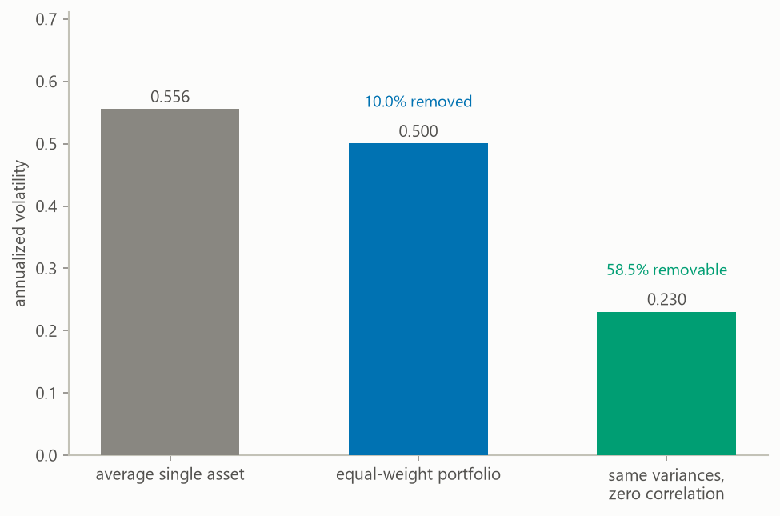

# crypto-sql-warehouse

A PostgreSQL warehouse for hourly crypto market data. It pulls hourly candles
from the public Coinbase Exchange API. A candle is the open, high, low, close,
and volume for one hour. The warehouse stores them in three schemas named raw,
core, and marts, laid out under Architecture. The marts hold daily rollups,
returns, rolling volatility, drawdowns, and pairwise correlations. Annotated
analytical queries run against the warehouse in `sql/04_queries.sql`.

I built it because I wanted a market-data layer I could query directly instead
of re-downloading CSVs every time I had a question. The private research system
behind my own trading has a much larger pipeline underneath it. This is the
public, inspectable version of the same habits.

The [report](reports/crypto_warehouse_report.pdf) asks how much volatility an
equal-weight holding of the six assets the warehouse loads actually removes.
It covers the method, the result, and the limitations. GitHub renders the PDF
inline.

Its main finding, over 175 complete trading days ending 2026-10-03, is that
spreading capital equally across all six assets removes only 9.9 percent of
the volatility of holding the average one. If the six were uncorrelated it
would remove 58.6 percent. Every pair of the six correlates between 0.73 and
0.89, averaging 0.78. A reload moves these figures, and the generated report is
their live copy. Holding six of these is close to holding one, and the report
explains what that does and does not justify.

The chart below is the report's Figure 4. Its three bars are the annualized
volatility of the average single asset, of the equal-weight portfolio, and of
that portfolio if the six assets were uncorrelated.



## Quick start

Requires git, Python 3.11 or 3.12, and a PostgreSQL server you can connect to.
Verified on PostgreSQL 17.10 and Python 3.11. Nothing in the SQL needs a
feature newer than PostgreSQL 10.

In a terminal, run the following.

1. Clone the repository:

   ```
   git clone https://github.com/RAStevenson/crypto-sql-warehouse.git
   ```

2. Navigate to the root directory:

   ```
   cd crypto-sql-warehouse
   ```

3. Create a new environment and activate it (on Mac or Linux the second line
   is `source .venv/bin/activate`):

   ```
   python -m venv .venv
   .venv\Scripts\activate
   ```

4. Install dependencies:

   ```
   pip install -r requirements.txt
   ```

5. Copy the example config (on Mac or Linux the command is
   `cp .env.example .env`), then edit `DATABASE_URL` in `.env` to point at your
   server:

   ```
   copy .env.example .env
   ```

6. Create the schema, load a year of history, and refresh the marts:

   ```
   python scripts/run_setup.py
   python scripts/run_ingest.py
   ```

7. Compute the metrics and figures from the loaded data, and render the
   report:

   ```
   python scripts/run_analysis.py
   ```

The first run of `run_ingest.py` fetches every active product at hourly grain.
A product is a Coinbase trading pair such as BTC-USD. The six seeded products
start out active. A year is 8,760 hours per product and the API caps a request
at 300 candles, so the default backfill is about 30 requests per product.
Later runs resume from the last loaded hour, called the watermark. Each run
also re-fetches the three hours before it, for the reason given under Design
decisions. At a daily cadence, a later run needs one request per product. The
loader refreshes the marts when it finishes, and `--no-refresh-marts` skips
that.

Other entry points:

```
python scripts/run_verify.py                    # warehouse assertions, nonzero exit on failure
python scripts/run_refresh_marts.py             # refresh the marts layer only
python scripts/run_build_report.py              # rebuild the report alone, without recomputing
python scripts/run_ingest.py --backfill-days 30 --products BTC-USD
python scripts/run_add_asset.py XRP-USD --name Ripple   # register and backfill a new asset
pytest                                          # the test suite
```

Every argument of every script, mirroring `--help`:

- `run_setup.py --reset` drops the raw, core, and marts schemas before
  applying the DDL. It deletes all stored data.
- `run_setup.py --rebuild-marts` drops and re-creates only the marts schema
  from `sql/02_marts.sql`. Use it to apply a changed mart definition to a
  warehouse that already holds data. Raw and core keep their data. It cannot
  be combined with `--reset`.
- `run_ingest.py --backfill-days N` sets how far back to reach, in days
  (default 365). For a product with no rows yet it is the depth of the first
  load. Passing it explicitly also makes it a floor on an existing product's
  resume point, so `--backfill-days 365` against a 90-day warehouse extends it
  back to a year. Omitting it leaves the run purely incremental.
- `run_ingest.py --products PRODUCT [PRODUCT ...]` names the product codes to
  load (default: every asset with `is_active` in `core.assets`). Naming a
  product explicitly loads it even when `is_active` is false, and the override
  is logged.
- `run_ingest.py --no-refresh-marts` skips the mart refresh that otherwise
  runs after loading.
- `run_add_asset.py PRODUCT` takes the Coinbase product code as its one
  required argument, e.g. `XRP-USD`.
- `run_add_asset.py --symbol SYMBOL` sets the ticker symbol to store
  (default: the part of the product code before the dash).
- `run_add_asset.py --name NAME` sets the human-readable asset name
  (default: the symbol).
- `run_add_asset.py --backfill-days N` sets the depth of the initial load in
  days (default 365).
- `run_add_asset.py --no-backfill` registers the asset only, and the next
  ingest run loads it. It cannot be combined with `--backfill-days`.
- `run_analysis.py --metrics PATH` sets the output path for the metrics file
  (default `reports/metrics.json`). Any other path skips the report, because
  the report builder reads only the default.
- `run_analysis.py --figures DIR` sets the output directory for the PNG
  figures (default `reports/figures`). Any other directory skips the report
  too, because the report builder embeds only the figures in the default directory.
- `run_analysis.py --no-report` skips rendering the HTML and PDF report after
  the metrics and figures.
- Every script except `run_build_report.py` accepts `--verbose` for
  debug-level logging. `run_refresh_marts.py` and `run_verify.py` take no
  other arguments, and `run_build_report.py` takes none at all.

Rerunning the loader is safe by construction, and `run_verify.py` asserts it.
One of its checks looks at the rows each product's latest run updated. If any
of them holds the same values as the copy an earlier run had already loaded,
the run rewrote a row it should have left alone, and the check fails.

The six seeded assets are a starting set, not a limit. `run_add_asset.py`
registers any Coinbase product after proving it answers with at least one
candle in the trailing three days, then backfills it and refreshes the marts,
so it appears in `marts.tableau_daily_extract` in the same run. Deactivating
one is a single statement, `UPDATE core.assets SET is_active = false WHERE product_code = 'XRP-USD'`, which
stops ingestion without deleting history.

## Scheduling

On my machine the loader runs daily through Windows Task Scheduler. The task
`crypto-warehouse-ingest` calls `scripts/scheduled_ingest.cmd` at 07:10 local
time. The script runs the default ingest from the repo root and appends its
log to `logs/`. It uses the Python in the repo's `.venv` when there is one,
and the `python` on PATH otherwise. Because every run resumes from the watermark, a day the machine was
off is made up in full by the next run, and `raw.ingest_runs` records what
each run did. To register the same task, with the repo path substituted:

```
$repo = "C:\path\to\crypto-sql-warehouse"
Register-ScheduledTask -TaskName 'crypto-warehouse-ingest' `
  -Action (New-ScheduledTaskAction -Execute 'cmd.exe' -Argument "/c `"$repo\scripts\scheduled_ingest.cmd`"") `
  -Trigger (New-ScheduledTaskTrigger -Daily -At 07:10) `
  -Settings (New-ScheduledTaskSettingsSet -StartWhenAvailable -ExecutionTimeLimit (New-TimeSpan -Hours 1))
```

On Mac or Linux the equivalent is one cron line calling
`scripts/run_ingest.py`.

## Architecture

```
Coinbase Exchange API (public, no key)
        |
        v  scripts/run_ingest.py  (windowed fetch, 300 candles/request)
+-------------------+
| raw               |  as-landed candles, append-only, plus a run audit table
|  raw.candles      |
|  raw.ingest_runs  |
+-------------------+
        |
        v  one INSERT ... ON CONFLICT per run
+-------------------+
| core              |  typed, deduplicated, constrained facts
|  core.assets      |
|  core.ohlcv_hourly|  PK (asset_id, ts_utc), OHLC CHECK constraints
+-------------------+
        |
        v  REFRESH MATERIALIZED VIEW CONCURRENTLY
+-------------------+
| marts             |  daily rollups, returns, rolling volatility,
|  daily_ohlcv      |  drawdowns, pairwise correlations
|  daily_metrics    |
|  pairwise_correlations_90d  |
|  tableau_daily_extract      |  <- Tableau connects here
+-------------------+
```

`raw.candles` is append-only, so a transform bug downstream is recoverable
without calling the API again. `raw.ingest_runs` is the exception that does get
updated, because it holds run status and row counts. Core is the layer
queries trust. Marts are presentation-shaped and rebuilt from core.

## Design decisions

The database enforces idempotency. The loader writes with an upsert, an
insert that becomes an update when the row already exists. The upsert targets the
natural primary key `(asset_id, ts_utc)`, so replaying any window changes
nothing in core unless the source data changed. The `DO UPDATE` has an `IS DISTINCT FROM`
guard, so unchanged rows are skipped entirely. That leaves no dead tuples, and
`updated_at` only moves when the data moved.

The pipeline re-fetches a three-hour overlap on every run to pick up late
candle revisions. For candles that were not revised, the upsert leaves core
unchanged. The overlap is not free. The
cost is at most one extra request per product per run, and up to four
duplicate rows per product per run in append-only `raw.candles`, three from
the overlap and one from re-fetching the watermark hour itself. Three hours is a guess at
Coinbase's revision window, not a measured bound.

A candle that would break one of core's constraints, such as a low of zero, is
left in raw and logged, and the rest of the run loads. If it were not left
out of core, that one candle would abort its product's upsert on that run and on
every later one, because the watermark could never move past it. The cost is
an hour missing from core for that product, and `run_verify.py` fails on that
hour until a valid copy of the candle is loaded.

Prices are stored as `numeric(20,8)` and volumes as `numeric(30,8)`. The API
returns JSON numbers,
which Python would ordinarily parse as float64, a type that cannot hold most
decimal prices exactly. The client parses them straight to `Decimal` instead,
and psycopg2 adapts that to `numeric`. Exactness
holds end to end rather than starting at the database boundary.

Queries are written to be independent of the session timezone, and the reason
is a bug. `date_trunc()` on a `timestamptz` buckets by the session
timezone, so on a server defaulting to America/Chicago the monthly aggregate query
(Q02 in `sql/04_queries.sql`) split its months at 05:00 UTC. I found it running the query set against a
live instance, and the `-05` display offsets were the visible symptom. My first
fix was `ALTER DATABASE ... SET timezone = 'UTC'`, which turned out to be
insufficient, because it only sets a default for sessions opened afterward
and any client can override it. `PGOPTIONS='-c timezone=...'` goes straight
through it, and any client that sets its own session timezone at connect
time, as JDBC drivers commonly do, gets through it the same way. The queries now use
`ts_utc AT TIME ZONE 'UTC'`, which returns a plain timestamp and cannot move.
The database pin stays as a second layer, and the verify suite has a
regression test. It re-runs the daily rollup's own defining query, read live
from the catalog, once under America/Chicago and once under UTC, and fails if
any row differs.

Daily bars are derived from hourly ones in SQL rather than fetched at daily
granularity. Both granularities then come from one source, so a disagreement
between daily and hourly bars can only be a rollup bug, which is findable, and never a source
discrepancy, which is not.

Incomplete days are kept as rows and excluded from every derived figure. A day
with fewer than 24 hourly candles still appears in `marts.daily_ohlcv` with its
open, high, low, close, volume, and an `is_complete` flag. Its return, moving
averages, volatility, and drawdown are NULL, and it does not enter the
correlation matrix. An earlier
version filtered incomplete days out at the presentation layer instead, which
hid the rows from the dashboard while leaving their effect baked into every
rolling metric computed around them. A trailing partial day has only a fraction
of a full day's volume, which quietly depressed the trailing baseline that the
volume-anomaly query compares against. Filtering at the end does not undo
contamination that already happened upstream.

Rolling metrics are NULL until their window is full. A 30-day annualized
volatility computed from four observations is not a 30-day volatility, so
`volatility_30d_ann`, `ma_30d`, and `ma_7d` return NULL until they have 30,
30, and 7 observations. Before this guard, roughly half the published volatility
values were warm-up values, and the first one for BTC was 0.2076 against 0.4043
for its first genuine 30-observation window.

The fact table is not partitioned. Six assets at hourly grain is roughly 53k
rows per year. Partitioning pays off orders of magnitude later, and until then
it complicates the upsert and the vacuum story for nothing. The DDL comments say
where the crossover is.

The three mart materialized views (matviews) have unique indexes so refreshes
run `CONCURRENTLY` and a live Tableau session never blocks. The loader runs
the three refreshes in one transaction, so a connected session sees all three views
change together. `tableau_daily_extract` is a plain view over `daily_metrics`, so it shows
whatever that matview last committed.

## Tableau

Connect Tableau to Postgres and point it at `marts.tableau_daily_extract`. It
holds one row per asset per day in long format, which is what Tableau's shelf
model wants.
The columns are `symbol`, `asset_name`, `trade_date`, `open`, `high`, `low`,
`close`, `volume_base_units`, `dollar_volume_approx`, `simple_return`, `ma_7d`,
`ma_30d`, `volatility_30d_ann`, `drawdown_from_peak`, `hours_present`, and
`is_complete`.

Incomplete days are present with NULL derived columns rather than dropped, so a
moving-average line breaks visibly at a gap instead of closing over it silently.

For a file-based extract instead of a live connection:

```
psql -d crypto_warehouse -c "\copy (SELECT * FROM marts.tableau_daily_extract ORDER BY symbol, trade_date) TO 'tableau_extract.csv' CSV HEADER"
```

## Limitations

One exchange and one quote currency, so there is no cross-venue check on a
suspicious print. The correlation mart is a fixed 90 days ending on the
latest day that has a return, not a rolling series. `dollar_volume_approx` multiplies
daily volume by the daily close rather than a traded average price. Measured
against volume times `(H+L+C)/3` over the data loaded as of 2026-08-04, the
error is -0.04 percent on average and ranges from -4.16 to +3.14 percent. The
column comment in `sql/02_marts.sql` is the source. The analytical caveats, including how the
report's correlation window differs from the mart's and how drawdown is
measured, are in the report.

## What I would build next

A dbt port of the marts layer would add tests and lineage. After that I would
add more granularities, and a data-quality report built from `raw.ingest_runs`
and the gap-detection query, since the loader now logs short API responses
but nothing surfaces them yet.

## Layout

```
scripts/run_setup.py          create the database and apply the DDL
scripts/run_ingest.py         incremental, idempotent loader; refreshes the marts
scripts/run_add_asset.py      validate, register, and backfill a new asset
scripts/scheduled_ingest.cmd  the Task Scheduler entry point, logs to logs/
scripts/run_verify.py         run the assertions, nonzero exit on failure
scripts/run_refresh_marts.py  refresh the marts layer
scripts/run_analysis.py       compute reports/metrics.json, figures, and the report
scripts/run_build_report.py   render the report from metrics.json
src/crypto_warehouse/         the package the scripts import
sql/01_schema.sql             schema DDL with design rationale in comments
sql/02_marts.sql              derived layers (rollups, volatility, correlations)
sql/03_refresh_marts.sql      mart refresh, dependency-ordered
sql/04_queries.sql            annotated analytical queries, each standalone
sql/05_verify.sql             the assertions, fatal on failure
tests/                        the test suite, no database or network needed
reports/                      the generated report, its metrics and figures
requirements.txt              exact pins the reported numbers were produced with
```
